<picture>
  <source media="(prefers-color-scheme: dark)" srcset="assets/hero-dark.svg">
  <source media="(prefers-color-scheme: light)" srcset="assets/hero-light.svg">
  
</picture>

# Vicente&nbsp;Siglic&nbsp;Moreno

**Machine&nbsp;Learning&nbsp;&amp;&nbsp;Software&nbsp;Engineering&nbsp;Student** · Data&nbsp;Science&nbsp;&amp;&nbsp;AI 
Models that predict, and the software that puts them to work

[LinkedIn](https://www.linkedin.com/in/vicente-siglic-68052725a/) &nbsp;·&nbsp; Antofagasta, Chile &nbsp;·&nbsp; **Open to internships**

## About me

I'm a fourth-year Civil Engineering in Computer Science and Informatics student at UCN, and I'm taking a data science specialization focused on AI. I work where machine learning meets software engineering: I explore the data, build and evaluate the models, and make sure they end up inside a product someone can actually use.

I care about honest evaluation. I test on years or months the model has never seen, compare against simple baselines, and keep the simple method when it wins.

## Teaching

- **Teaching assistant, Web and Mobile Development** (current). I teach backend development with FastAPI to about 25 students on average.
- **Teaching assistant, Software Engineering** (one year). Good practices, classic and agile methodologies, requirements, diagrams and architectures.
- **Teaching assistant, Data Science.** Web scraping, data handling with pandas and NumPy, and many classic machine learning models, from linear regression to clustering: K-means, SVM, decision trees, naive Bayes and more. Material from it: [Pandas-y-Numpy](https://github.com/Tsukuyomi-tsk/Pandas-y-Numpy).

## Hackathons

I won both of these together with [Sebastián Cortez](https://github.com/sxbast1anCZ). My part was the data and the machine learning.

### 🥇 NASA Space Apps Challenge 2026 · Antofagasta winner, Global nominee · Fireguard

<picture>
  <source media="(prefers-color-scheme: dark)" srcset="assets/work-fireguard-model-dark.svg">
  <source media="(prefers-color-scheme: light)" srcset="assets/work-fireguard-model-light.svg">
  
</picture>

Challenge: harmonizing MODIS and VIIRS hotspots. My main role was the data exploration behind the harmonization, and designing, building and evaluating the next-day model. The model catches 78.0% (Argentina) and 79.1% (Chile) of the cell-days with a hotspot on 2023–2025, years it never saw in training. At the same number of alerts, that is 79% against 64% and 68% against 49% for the rule "fire today in the cell or a neighbour". Every alert comes with a reason from SHAP values, and the write-up says plainly that most alerts end with no hotspot. [Repo](https://github.com/sxbast1anCZ/NASA-Space-Apps-2026)

`Python` `pandas` `PostgreSQL` `LightGBM` `SHAP` `NASA FIRMS`

### 🥇 Hackadisc 2026 · Insecap

<picture>
  <source media="(prefers-color-scheme: dark)" srcset="assets/work-insecap-models-dark.svg">
  <source media="(prefers-color-scheme: light)" srcset="assets/work-insecap-models-light.svg">
  
</picture>

A commercial dashboard for Insecap, with a view for management and one for each sales executive. I explored the financial data and built the statistical and machine learning models behind it: a forecast of how the month's sales will close, a payments model (days to invoice and late-payment risk) and a client risk model (churn, volume drop, credit). I chose each method with a rolling-origin backtest against the alternatives, and the winner was often the simple one. The models run offline, write tables, and the KPI API that Sebastián built only reads them. The models repo is private, so it is not linked. [Team backend](https://github.com/sxbast1anCZ/Hackadisc-back-26) · [Team frontend](https://github.com/sxbast1anCZ/Hackadisc-front-26)

`scikit-learn` `LightGBM` `Random Forest` `Time series` `pandas`

## Software engineering

### GameVault UCN · layered backend

<picture>
  <source media="(prefers-color-scheme: dark)" srcset="assets/work-gamevault-layers-dark.svg">
  <source media="(prefers-color-scheme: light)" srcset="assets/work-gamevault-layers-light.svg">
  
</picture>

The REST API of a digital game store, built for the web and mobile development course at UCN. I used a layered architecture, **routers → services → repositories → models**, with one strict rule per layer, so that each piece can be read and tested on its own. It has email-verified sign-up, JWT with a token blacklist, rate limiting, a catalog with search and filters, a cart, idempotent checkout with a PDF receipt, reviews, a wishlist, an admin backoffice and scheduled cleanup jobs. It is an academic project, and its README says what is not hardened for production. [Repo](https://github.com/Tsukuyomi-tsk/GameVaultUCN1)

`FastAPI` `SQLModel` `SQLite` `Alembic` `JWT` `APScheduler` `Ruff`

## More projects

- **[PIPELINE-Scraper](https://github.com/Tsukuyomi-tsk/PIPELINE-Scraper)**: a Selenium scraper for books.toscrape.com that stores what it collects in a relational database with SQLModel.
- **[linear-regression-guide](https://github.com/Tsukuyomi-tsk/linear-regression-guide)**: a guide to simple and multiple linear regression on 25,000 deliberately dirty housing records, to show how data cleaning changes the result.
- **[Selection algorithms](https://github.com/Tsukuyomi-tsk/Algorithm-Design-and-Analysis-Performance-Evaluation-of-Selection-Algorithms)**: merge-sort selection, Quickselect and median of medians (BFPRT) in pure Python, with a performance evaluation.

## Stack

`Python` `pandas` `NumPy` `scikit-learn` `LightGBM` `SHAP` `Jupyter` `FastAPI` `SQLModel` `SQLite` `PostgreSQL` `Alembic` `Git`
